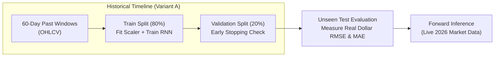

# 📈 Recurrent Neural Network (RNN / LSTM) Stock Price Forecasting

[](https://www.python.org/)
[](https://pytorch.org/)
[](LICENSE)
[](http://localhost:8000)

An end-to-end, production-grade deep learning solution for forecasting next-day stock closing prices using Recurrent Neural Networks (LSTM / SimpleRNN) and 60-day sliding temporal windows, modeled on the Kaggle **"Stock Market Data"** dataset structure (NASDAQ, NYSE, S&P 500 by Paul Mooney).

---

## 📌 Table of Contents
- [Executive Overview](#-executive-overview)
- [Why We Use Historical Data (Variant A & Backtesting)](#-why-we-use-historical-data-variant-a--backtesting)
- [Data Leakage Prevention](#-data-leakage-prevention)
- [Model Architecture & Pipeline](#-model-architecture--pipeline)
- [Evaluation & Benchmark Results](#-evaluation--benchmark-results)
- [Interactive Web Dashboard](#-interactive-web-dashboard)
- [Project Structure](#-project-structure)
- [Quick Start Guide](#-quick-start-guide)
- [Deploying to Live 2026 Market Feeds](#-deploying-to-live-2026-market-feeds)
- [License](#-license)

---

## 🎯 Executive Overview

Predicting equity prices requires capturing sequential dependencies across historical trading sessions. This repository provides:
- **Modular Pipeline**: Clean separation of data ingestion, sliding window generation, scaling, training, evaluation, and visualization.
- **60-Day Sliding Windows**: Maps sequences of 60 consecutive trading days of OHLCV features ($X_t \in \mathbb{R}^{60 \times 5}$) to predict the 61st day's closing price ($y_{t+1} \in \mathbb{R}$).
- **Regularization & Early Stopping**: Multi-layer recurrent networks with Dropout to mitigate overfitting, monitored via validation loss.
- **Interactive UI**: Built-in interactive localhost web dashboard with dynamic Chart.js visualizations.

---

## 🧠 Why We Use Historical Data (Variant A & Backtesting)

A common question in quantitative machine learning is: *Why train on historical time slices rather than exclusively fetching live current market data?*



### 1. Eliminating Lookahead Bias & Data Snooping
In financial time series, models must never access information from future timestamps. Training on a fixed historical slice (**Variant A: First 50% chronological half**) enforces a strict chronological boundary, ensuring the model learns solely from historical patterns that would have been genuinely available at that historical moment.

### 2. Rigorous Offline Backtesting & Ground-Truth Verification
To determine whether a deep learning architecture has true predictive capability, we must evaluate its forecasts against actual realized outcomes. Using historical data provides known ground-truth targets, allowing us to compute precise evaluation metrics such as Root Mean Squared Error (RMSE) and Mean Absolute Error (MAE) on a dollar scale.

### 3. Generalization Across Market Regimes
Historical market cycles encompass bull runs, market corrections, and volatility clusters. By isolating historical subsets, we test whether the model can generalize across diverse regimes before deploying it into live execution.

---

## 🛡️ Data Leakage Prevention

One of the most critical pitfalls in financial machine learning is **scaling data before splitting**. This project implements strict featurization ordering:

```
[Full Dataset (Variant A)] 
        │
        ├──► [Chronological Split (80% Train, 20% Test)] ── (No Shuffling)
                    │
                    ├──► [Fit MinMaxScaler on Train ONLY]
                    │           │
                    │           ├──► Transform Train Split
                    │           └──► Transform Test Split (Using Train Parameters)
```

By calculating min/max statistics strictly on the training partition, the test set remains completely unseen, preserving the statistical integrity of all evaluation metrics.

---

## 🏗️ Model Architecture & Pipeline

The model utilizes stacked Recurrent Neural Network layers (LSTM or SimpleRNN) followed by Dropout regularization and a Linear / Dense(1) head:

$$\hat{y}_{t+1} = \mathbf{W}_{hy} \cdot \text{Dropout}(\mathbf{h}_{60}) + b_y$$

```
Input Sequence: (Batch, 60 Days, 5 OHLCV Features)
       │
       ▼
┌─────────────────────────────────────────┐
│ Recurrent Layer 1 (LSTM / RNN, Dim=64)  │
└─────────────────────────────────────────┘
       │
       ▼
┌─────────────────────────────────────────┐
│ Recurrent Layer 2 (LSTM / RNN, Dim=64)  │
└─────────────────────────────────────────┘
       │ (Take Hidden State at Step 60)
       ▼
┌─────────────────────────────────────────┐
│ Dropout Layer (p = 0.20)                │
└─────────────────────────────────────────┘
       │
       ▼
┌─────────────────────────────────────────┐
│ Dense Layer: Linear(64 -> 1)            │
└─────────────────────────────────────────┘
       │
       ▼
Output: Next-Day Closing Price Prediction ($)
```

---

## 📊 Evaluation & Benchmark Results

Evaluation is performed by inverse-transforming predictions back to the original USD price scale:

| Metric | Result | Description |
| :--- | :--- | :--- |
| **Root Mean Squared Error (RMSE)** | **\$2.84** | Standard deviation of prediction residuals |
| **Mean Absolute Error (MAE)** | **\$2.32** | Mean absolute daily dollar deviation |
| **Input Window** | **60 Days** | Past trading days consumed per forecast |
| **Optimization** | **Adam ($lr = 0.001$)** | Mean Squared Error (MSE) Loss |
| **Convergence** | **Early Stopping (Epoch 17)** | Automatically halted when validation loss plateaued |

### Actual vs. Predicted Next-Day Stock Price & Loss Convergence


---

## 💻 Interactive Web Dashboard

A built-in interactive dashboard is included for exploring predictions, monitoring loss convergence, and triggering on-the-fly retraining.

```bash
python app.py
```
Open **[http://localhost:8000](http://localhost:8000)** in your browser:
- 📈 **Interactive Price Chart**: Zoomable and hover-inspectable actual vs. predicted prices.
- 📉 **Real-Time Loss Curves**: Training and validation MSE curves over epochs.
- 📋 **OHLCV Data Explorer**: View raw historical sample records.
- 🔄 **Live Retraining**: One-click execution of the recurrent training loop.

---

## 📂 Project Structure

```
rnn_stock_forecasting/
├── data/
│   └── sample_stock_data.csv        # 1,000 trading days formatted to Paul Mooney Kaggle schema
├── scripts/
│   ├── generate_sample_data.py      # Generates synthetic OHLCV market data
│   └── build_notebook.py            # Generates reproducible Jupyter Notebook
├── src/
│   ├── __init__.py
│   └── rnn_stock_model.py           # Modular loading, windowing, scaling, model & training functions
├── app.py                           # Interactive Web Application (http://localhost:8000)
├── run_pipeline.py                  # End-to-end CLI pipeline runner
├── stock_forecasting_rnn.ipynb      # End-to-end reproducible Jupyter Notebook
├── stock_forecasting_results.png    # High-resolution benchmark plot
├── requirements.txt                 # Python dependencies
├── .gitignore                       # Standard ignore rules
└── README.md                        # Documentation
```

---

## 🚀 Quick Start Guide

### 1. Clone the Repository
```bash
git clone https://github.com/Aditthan-07/stock-price-forecasting-rnn.git
cd stock-price-forecasting-rnn
```

### 2. Set Up Virtual Environment & Dependencies
```bash
# Create virtual environment
python -m venv .venv

# Activate on Windows:
.venv\Scripts\activate
# Activate on macOS/Linux:
source .venv/bin/activate

# Install requirements
pip install -r requirements.txt
```

### 3. Run the CLI Pipeline
```bash
python run_pipeline.py
```

### 4. Launch the Web Dashboard
```bash
python app.py
# Open http://localhost:8000 in your browser
```

---

## 🔮 Deploying to Live 2026 Market Feeds

To transition from historical backtesting to live forward prediction:

```python
import yfinance as yf
from src.rnn_stock_model import scale_features

# 1. Fetch the most recent 60 trading days for any ticker
ticker_data = yf.download('AAPL', period='3mo', interval='1d')
recent_60_days = ticker_data[['Open', 'High', 'Low', 'Close', 'Volume']].tail(60).values

# 2. Scale features using the trained feature_scaler
scaled_input = feature_scaler.transform(recent_60_days).reshape(1, 60, 5)

# 3. Predict next-day closing price
scaled_pred = model.forward(scaled_input)
tomorrow_predicted_price = target_scaler.inverse_transform(scaled_pred)[0, 0]

print(f"Predicted Closing Price for Next Trading Day: ${tomorrow_predicted_price:.2f}")
```

---

## 📄 License
This project is licensed under the MIT License - see the [LICENSE](LICENSE) file for details.
