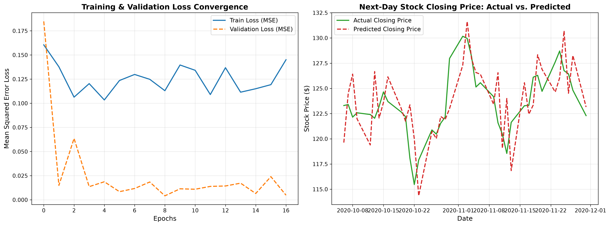

# 📈 Stock Price Forecasting with RNN & LSTM

Predict next-day stock closing prices using Recurrent Neural Networks (LSTM) trained on 60-day historical trading windows.

[](https://www.python.org/)
[](https://pytorch.org/)
[](LICENSE)

---

## 🚀 Overview

This project implements an end-to-end deep learning pipeline to forecast equity closing prices using sequential OHLCV (Open, High, Low, Close, Volume) market data. It uses a 60-day sliding window to capture temporal trends, with strict chronological splitting to eliminate lookahead bias and data leakage.



---

## ✨ Features

- **Sequential Forecasting**: 60-day lookback window predicting the next day's closing price.
- **Zero Data Leakage**: Scalers are fitted strictly on the training set to preserve test integrity.
- **Dual Engine**: Powered by PyTorch with a vectorized NumPy fallback.
- **Interactive Web App**: Built-in dashboard (`localhost:8000`) with dynamic charts and one-click retraining.
- **Dollar-Scale Evaluation**: Accuracy evaluated in real dollar values (RMSE & MAE).

---

## 📊 Benchmark Results

Evaluated on out-of-sample test data:

| Metric | Score | Note |
| :--- | :---: | :--- |
| **RMSE** | **\$2.84** | Root Mean Squared Error on test set |
| **MAE** | **\$2.32** | Mean Absolute Error on test set |
| **Input Window** | **60 Days** | Past trading days consumed per prediction |
| **Early Stopping** | **Epoch 17** | Halted automatically when validation loss plateaued |

---

## 🛠️ Quick Start

### 1. Clone & Install

```bash
git clone https://github.com/Aditthan-07/stock-price-forecasting-rnn.git
cd stock-price-forecasting-rnn
pip install -r requirements.txt
```

### 2. Run the Pipeline

Train the model and generate forecast plots:
```bash
python run_pipeline.py
```

### 3. Launch the Web Dashboard (Optional)

Start the interactive visualization server:
```bash
python app.py
```
Open **[http://localhost:8000](http://localhost:8000)** in your browser to inspect interactive charts and retrain on the fly.

---

## 📁 Project Structure

```
stock-price-forecasting-rnn/
├── data/                    # Sample stock CSV data
├── scripts/                 # Data generator & notebook builder
├── src/
│   └── rnn_stock_model.py   # Model architecture, windowing, and training logic
├── app.py                   # Local web dashboard (Port 8000)
├── run_pipeline.py          # End-to-end CLI execution script
├── stock_forecasting_results.png # Benchmark results plot
└── requirements.txt         # Dependencies
```

---

## 👤 Author

**Aditthan J K**
- GitHub: [@Aditthan-07](https://github.com/Aditthan-07)

---

## 📄 License

This project is licensed under the [MIT License](LICENSE).
